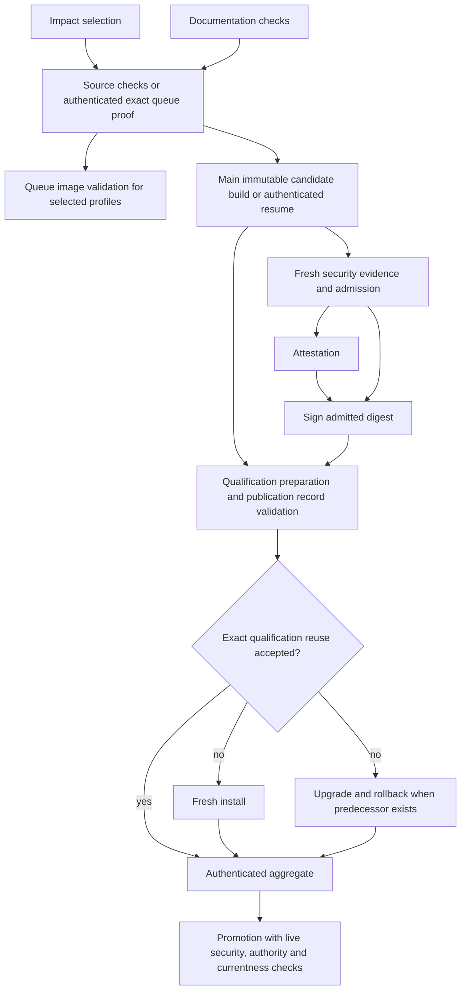

# CI dependency graph and publishing audit, October 26 UTC

Audited main `0afe8b2fdd04d73687473dde587f8356c65d8ba5` after #284.
Its [main workflow](https://github.com/closure-labs/finite/actions/runs/40412281994)
and subsequent delivery-health and reconciliation callbacks succeeded.
This report adds a smaller publication graph and an explicit no-FlakeHub-publishing
boundary. Hosted rollout evidence for these new changes is still pending.

## FlakeHub boundary

No explicit FlakeHub publisher or cache-upload action remains in any registered
workflow, checked-in workflow, composite action or publication script. FlakeHub
URLs in the lockfiles and Nixpkgs input declarations are dependency downloads.
They remain unchanged.

The pinned Determinate installer had an implicit authentication path:
[inner action source](https://github.com/DeterminateSystems/nix-installer-action/blob/2cb76beab460be7e44442c7ebdcbc30b638416df/src/index.ts)
calls `determinate-nixd login github-action` when both GitHub OIDC endpoint
variables are available. Both installation sites now supply empty values for
those variables only to the installer action. This prevents that login without
changing the Nix implementation, dependency pins, public cache downloads or OIDC
access for later signing and attestation steps. There is no FlakeHub push/cache
action; the installer login itself was authentication, not proof of a prior upload.

The hosted aggregate's toolchain regression scans every workflow/composite action
for FlakeHub publishing/cache actions and publishing commands, and requires this
installer boundary at both installation sites. Changes to the pinned upstream
installer still require review because upstream behavior can change.

## Required graph

Ordinary PRs run source checks. The protected queue performs selected image
validation. Main consumes an authenticated source proof only for an exact eligible
queue producer; missing or invalid proof falls back to the aggregate. Queue and
main are separate event paths, not simultaneous consumers on one run.

Publication preparation previously allocated an additional runner per profile
between signing and qualification. Its record download and exact
`publication-current.py --record` validation now execute in qualification's
existing preparation job, before reuse lookup or installation of VM tools. The
caller supplies the same native build artifact name; production rejects missing,
wrong-profile, wrong-run and wrong-attempt names. Download or record validation
failure prevents both VM phases and qualification reuse. Manual branch diagnostics
retain their separate eligibility boundary and do not consume production records.

The change removes two runner allocations, checkouts, Nix setups and cleanups per
normal two-profile publication. The small record download and validation still
run. No measured wall-time saving is claimed before a natural rollout completes.

## Asset ownership and reuse limits

| Asset | Producer and consumer | Acceptance boundary |
| --- | --- | --- |
| Source check proof | Protected queue to main source job | Exact source, producer identity, pinned aggregate and authenticated artifact; full fallback |
| Candidate image and inventory | Native image job to security and publication | Immutable digest and authenticated build identity; resumed candidate independently checked |
| Security evidence | Scanner to attestation, signer and promoter | Exact candidate, fresh policy/admission and live human authority |
| Qualification | Successful native phases to aggregate or exact reuse | Candidate, predecessor, source/tool/firmware context, native producer and complete acceptance evidence |
| Preserved ISO | Qualified producer to predecessor installation | Existing authenticated same-context eligibility; ordinary missing/ineligible evidence builds again |
| Release products | Governed proposal to publisher | Existing packet provenance, product hashes, independent approval, reservation and publication checks |

Source and tool caches accelerate acquisition; they do not replace validation.
Fresh-install and upgrade phases run concurrently after signing. Both profiles
remain independent until paired release preparation. Final promotion checks run
again because authority, source and security freshness can change during VM work.
Moving them earlier would not authorize the later mutation.

## Remaining measured work

The [release ledger](v0.8.3-release-plan.md) retains the adoption gates. The
historical-provenance worker prototype merged with its serial default; ongoing
parallel mode still needs a bounded complete-job canary. The producer receipt
transport prototype remains subject to five matched warm pairs and one cold pair.
Neither is enabled by this graph change.

Installer ISO construction and VM installation dominate the recent queue sample;
see the [release ledger](v0.8.3-release-plan.md). Installer
runtime reuse remains blocked on a complete input boundary, including per-run
upgrade configuration. Guest closure transport needs Foundation timing evidence.
Installing VM tools before an inevitably ineligible qualification-reuse lookup is
another measurement candidate; a cheap eligibility probe must not become an
acceptance shortcut. Queue image export cannot substitute for signed production
qualification until exact OCI identity and native producer provenance are proved.

These larger changes remain proposals. Automatic Cachix writing and Grype database
transport remain disabled. Stable release freeze and the authorized workstation
pilot still require their release-ledger evidence.

## Verification

The 86 focused toolchain, qualification, publication-authority and selection
regressions passed. Failure fixtures cover wrong/missing native artifact names,
interrupted acquisition and rejected publication records; existing qualification
fixtures cover exact context, source eligibility and partial evidence. Actionlint
through the checked self-reference adapter and offline Zizmor passed. Documentation
checks passed. The pinned hosted aggregate and protected queue remain required
before merging; no local Nix build or VM round was run for this audit.
